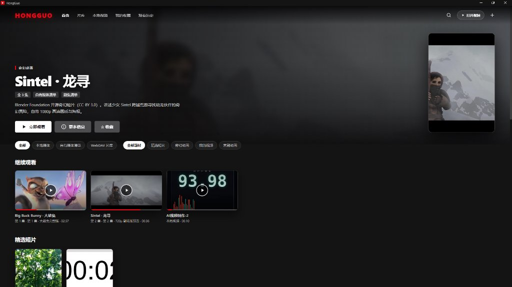

# HongGuoRust

面向 Windows 10/11 x64 的开源桌面影院与剧集播放客户端。基于 **Rust + Tauri 2 + libmpv + React/TypeScript** 构建，采用暗黑影院风格界面与透明悬浮播放控制层，支持本地视频、WebDAV 媒体库与远程/本地 JSON 剧集订阅清单。项目采用 `GPL-3.0-only` 协议开源。

## 运行截图

### 首页与片库发现


### 透明悬浮播放控制条


## 当前功能

- **暗黑影院风格界面**
  - 原生 Windows 暗色标题栏与自定义应用图标，与 `#141414` 界面无缝融合。
  - 首页包含焦点大图（Hero Billboard）、横向滚动的「继续观看」与题材海报轨道、来源/题材筛选及全局搜索。
  - 剧集详情页支持简介展开、全剧观看进度总览、按集数/标题精确搜索、观看状态筛选与正倒序排列。
- **原生 `libmpv` 播放与透明叠加控制层**
  - 由 Rust 独占管理 `libmpv` 播放会话，视频铺满主窗口，控制条通过透明从属叠加窗口浮于画面之上。
  - 播放时鼠标静止自动隐藏控制条与光标；支持单击播放/暂停、双击全屏、悬停进度条实时缩略图预览、`0.5×–2.0×` 倍速、音量与静音记忆、多音轨/字幕切换、右侧滑出式选集抽屉及完整键盘快捷键。
  - 自动读取 Windows 系统 HTTP 代理用于外网 HTTPS 流媒体播放，局域网与本机地址自动直连。
- **多来源内容接入**
  - **本地视频库**：管理本机视频，记录观看历史、断点续播与收藏；支持 **Windows 资源管理器右键「打开方式」** 直接播放（支持 `.mp4`、`.mkv`、`.mov`、`.m4v`、`.webm`、`.avi`、`.flv`、`.ts`）。
  - **WebDAV 媒体库**：兼容 Alist / OpenList、群晖/飞牛 NAS、Nextcloud、rclone 等标准 WebDAV 服务，支持 Basic 认证，自动将文件夹结构聚合成多集剧集并按自然集数排序，直接流式播放与断点续播。
  - **远程与本地 JSON 清单**：支持粘贴公开 HTTPS JSON 链接订阅并一键刷新，或导入本地 `.json` 清单（支持 `coverUrl` 海报配置；仓库附带开源电影示例 [open-cinema-manifest.json](docs/fixtures/open-cinema-manifest.json)）。
- **自动视频帧封面缓存**
  - 无海报图的本地视频、清单影片与 WebDAV 视频会在后台自动抽取视频帧作为封面和首页背景，并缓存于本机 `%LOCALAPPDATA%\HongGuoRust\thumbnails`。
- **统一「我的收藏」与「观看历史」**
  - 支持在首页、片库与详情页一键收藏任意来源剧集与本地视频，集中管理并持久化保存于本机应用数据目录。

## 下载与安装（Windows x64）

前往 [GitHub Releases](https://github.com/Zhaokangbo/HongGuoRust/releases) 下载最新版本（均已内置 `libmpv-2.dll` 与 `vulkan-1.dll` 运行时，安装/解压即可直接使用）：

- **安装版（推荐）**：`HongGuoRust-*-windows-x64-setup.exe` — 双击安装，自动创建开始菜单快捷方式并注册视频文件右键「打开方式」关联。
- **绿色便携版**：`HongGuoRust-*-windows-x64-portable.zip` — 解压后直接双击 `hongguorust.exe` 运行。

> 提示：应用首次运行时若系统尚未安装 Microsoft Edge WebView2 Runtime，安装程序会自动引导补装。

## Windows 本地开发与构建

环境要求：Visual Studio 2022（C++ 桌面开发工具与 Windows SDK）、Rust stable MSVC x64、Node.js 22.12+ / 24 LTS、WebView2 Runtime。

```powershell
Set-ExecutionPolicy -Scope Process -ExecutionPolicy Bypass
cargo install tauri-cli --version 2.11.4 --locked

# 1. 准备 libmpv 运行时与 MSVC 导入库
$native = Join-Path $env:TEMP 'HongGuoRust-mpv'
.\scripts\prepare-mpv-msvc.ps1 -Destination $native
$env:LIB = "$native;$env:LIB"
$env:PATH = "$native;$env:PATH"

# 2. 安装前端依赖并启动开发模式
npm.cmd ci
cargo tauri dev
```

编译独立桌面版可执行文件：

```powershell
npm.cmd install --prefix .\scripts\hg2a-sdk --ignore-scripts
cargo tauri build --no-bundle -- --locked
Copy-Item "$native\libmpv-2.dll" .\src-tauri\target\release\ -Force
.\src-tauri\target\release\hongguorust.exe
```

## 非官方与内容声明

HongGuoRust 为独立开发的非官方开源桌面播放器，与红果及相关平台无隶属或合作关系。软件本身不内置、不抓取、不解密也不分发第三方受版权保护的媒体内容；所有本地文件、WebDAV 服务与 JSON 订阅清单均由用户自行配置并确认合法使用权限。
