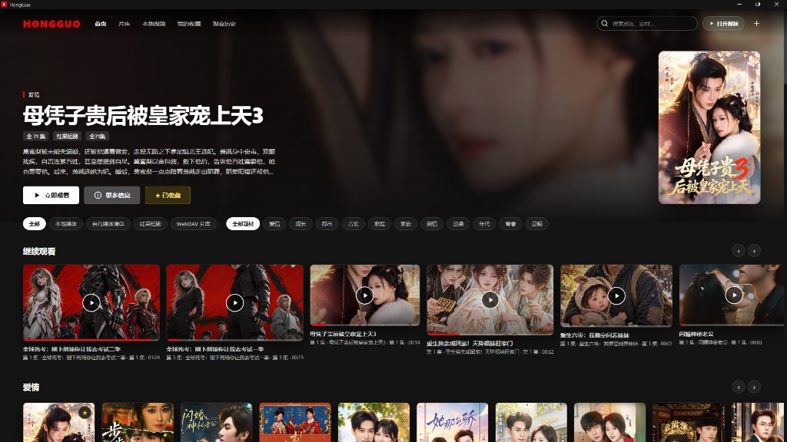
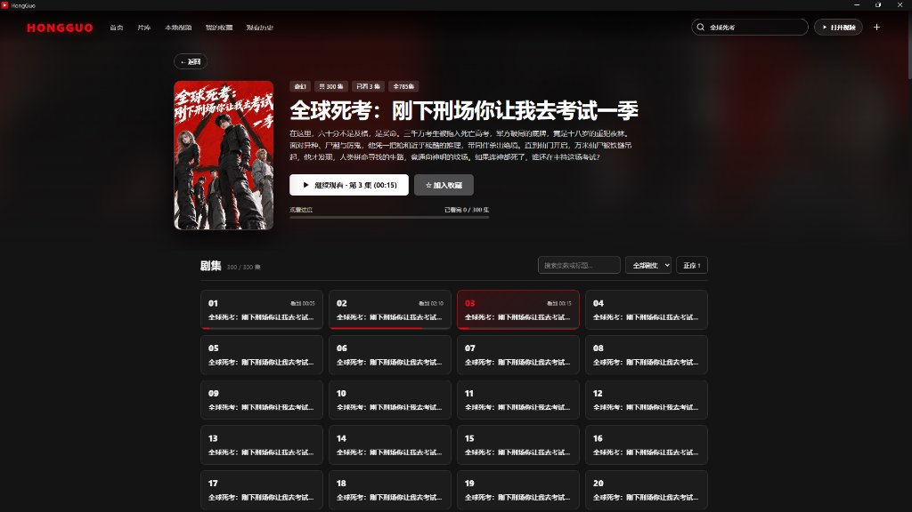

# HongGuoRust

面向 Windows 10/11 x64 的开源桌面影院与短剧播放客户端。基于 **Rust + Tauri 2 + libmpv + React/TypeScript** 构建，采用暗黑影院风格界面与透明悬浮播放控制层，内置红果短剧真实片源解析、在线 CENC 流解密、原站时间轴弹幕、多档清晰度切换，同时支持本地视频、WebDAV 媒体库与远程/本地 JSON 剧集订阅清单。项目采用 `GPL-3.0-only` 协议开源。

## 运行截图

### 首页推荐与继续观看


### 1080P 播放、原站滚动弹幕与清晰度切换


### 剧集详情与分集进度管理


## 当前已完成功能（v0.2.0）

- **红果短剧真实片源与 CDN 播放架构（HG-4，零新增 Cargo 依赖）**
  - **多页片库发现与搜索**：接入红果公开 SSR 分类与搜索接口，支持片库多页渐进加载（支持触底自动加载与「加载更多」，覆盖全部 34 页 / 800 部推荐短剧）以及关键词多页搜索与 v3 App 搜索兜底。
  - **纯 Rust 协议签名与匿名设备注册**：原生实现 MD5 / SHA-512 / SM3 / AES-128（ECB/CBC/CTR）/ Gzip 与 Android v5 (`v04.10.03`, `field 21 = 312`) / v3 签名及匿名设备注册与冷却轮换，全程在内存中完成，无需登录、不落盘任何凭据。
  - **多路径播放模型解析与编码协商**：支持 `reading.snssdk.com/.../preload/v1` 主路径、`video_tab` 备用路径及多域名回退，自动过滤不兼容的 `bytevc2` 编码并支持 `fallback_api`（`codec_type=1/3`）兼容协商。
  - **本机流式解密代理与 CDN 容灾**：内置仅监听 `127.0.0.1` 随机端口的 HTTP/1.1 Range 流代理（256-bit `X-HGR-Stream-Token` 常量时间鉴权），支持 MP4 CENC（`spade_a` + `moov/sinf/saiz/saio`）任意字节偏移在线 AES-128-CTR 解密、原始编码还原与主/备 CDN 头校验容灾切换。
  - **清晰度实时切换**：默认自动选择最高可用兼容画质（如 1080P，同清晰度优先 H.264/AVC），播放器控制栏支持一键切换本集全部真实清晰度档位（1080P / 720P / 540P / 480P / 360P）并保留当前秒数无缝续播。
  - **原站时间轴弹幕**：纯 Rust 移植官方分时弹幕签名（`X-Gorgon / X-Argus / X-Ladon`）与分段拉取；播放器透明叠加层内置 8 轨道平滑滚动弹幕，自动同步播放进度、倍速、暂停与拖拽定位，并支持开关与透明度调节。
  - **分集标题与进度续播**：剧集详情页规范展示分集标题（`剧名 · 第 N 集` 或上游单集标题），并以稳定进度键（`hongguo:{series_id}:{episode_id}`）持久化观看历史，不因 CDN 链接过期丢失续播进度。
- **暗黑影院风格界面**
  - 原生 Windows 暗色标题栏与自定义应用图标，与 `#141414` 界面无缝融合。
  - 首页包含焦点大图（Hero Billboard）、横向滚动的「继续观看」与题材海报轨道、来源/题材筛选及全局搜索。
  - 剧集详情页支持简介展开、全剧观看进度总览、按集数/标题精确搜索、观看状态筛选与正倒序排列。
- **原生 `libmpv` 播放与透明叠加控制层**
  - 由 Rust 独占管理 `libmpv` 播放会话，视频铺满主窗口，控制条与滚动弹幕通过透明从属叠加窗口浮于画面之上。
  - 播放时鼠标静止自动隐藏控制条与光标；支持单击播放/暂停、双击全屏、悬停进度条实时缩略图预览、`0.5×–2.0×` 倍速、音量与静音记忆、清晰度/弹幕/多音轨/字幕切换、右侧滑出式选集抽屉及完整键盘快捷键。
  - 自动适配 Windows 系统代理并在代理异常重置时自动回退直连，局域网与本机回环流始终直连。
- **多来源内容接入与统一管理**
  - **本地视频库**：管理本机视频，记录观看历史、断点续播与收藏；支持 **Windows 资源管理器右键「打开方式」** 直接播放（`.mp4`、`.mkv`、`.mov`、`.m4v`、`.webm`、`.avi`、`.flv`、`.ts`）。
  - **WebDAV 媒体库**：兼容 Alist / OpenList、群晖/飞牛 NAS、Nextcloud、rclone 等标准 WebDAV 服务，支持 Basic 认证，自动聚合多集剧集并按自然集数排序。
  - **远程与本地 JSON 清单**：支持公开 HTTPS JSON 链接订阅与一键刷新，或导入本地 `.json` 清单（仓库附带开源电影示例 [open-cinema-manifest.json](docs/fixtures/open-cinema-manifest.json)）。
  - **自动视频帧封面缓存 & 统一「我的收藏 / 观看历史」**：无海报图的本地与 WebDAV 视频会在后台自动抽帧缓存于 `%LOCALAPPDATA%\HongGuoRust\thumbnails`，收藏与历史跨来源统一管理。

## 下载与安装（Windows x64）

前往 [GitHub Releases](https://github.com/Zhaokangbo/HongGuoRust/releases) 直接下载由 GitHub Actions 自动编译发布的最新版本（均已内置 `libmpv-2.dll` 与 `vulkan-1.dll` 运行时，安装/解压即可直接使用）：

- **安装版（推荐）**：`HongGuoRust-*-windows-x64-setup.exe` — 双击一键安装，自动创建开始菜单快捷方式并注册视频文件右键「打开方式」关联。
- **绿色便携版**：`HongGuoRust-*-windows-x64-portable.zip` — 解压后直接双击 `hongguorust.exe` 运行。

> 提示：应用首次运行时若系统尚未安装 Microsoft Edge WebView2 Runtime，安装程序会自动引导补装。

## Windows 本地开发与构建

环境要求：Visual Studio 2022（C++ 桌面开发工具与 Windows SDK）、Rust stable MSVC x64、Node.js 22.12+ / 24 LTS、WebView2 Runtime。

```powershell
Set-ExecutionPolicy -Scope Process -ExecutionPolicy Bypass
cargo install tauri-cli --version 2.11.4 --locked

# 1. 准备 libmpv 运行时与 MSVC 导入库
$native = Join-Path $env:TEMP 'HongGuoRust-mpv'
.\scripts\prepare-mpv-msvc.ps1 -Destination $native
$env:LIB = "$native;$env:LIB"
$env:PATH = "$native;$env:PATH"

# 2. 安装前端依赖并启动开发模式
npm.cmd ci
cargo tauri dev
```

编译独立桌面版可执行文件：

```powershell
npm.cmd install --prefix .\scripts\hg2a-sdk --ignore-scripts
cargo tauri build --no-bundle -- --locked
Copy-Item "$native\libmpv-2.dll" .\src-tauri\target\release\ -Force
.\src-tauri\target\release\hongguorust.exe
```

## 致谢与许可声明

- 协议研究与架构参考：[N3urda/hongguoTV](https://github.com/N3urda/hongguoTV)（`GPL-3.0-only`）。
- 本项目以 `GPL-3.0-only` 协议开源，为独立开发的非官方开源桌面客户端，与红果及相关平台无隶属或合作关系，仅用于技术学习与个人本地/合法媒体播放研究。
